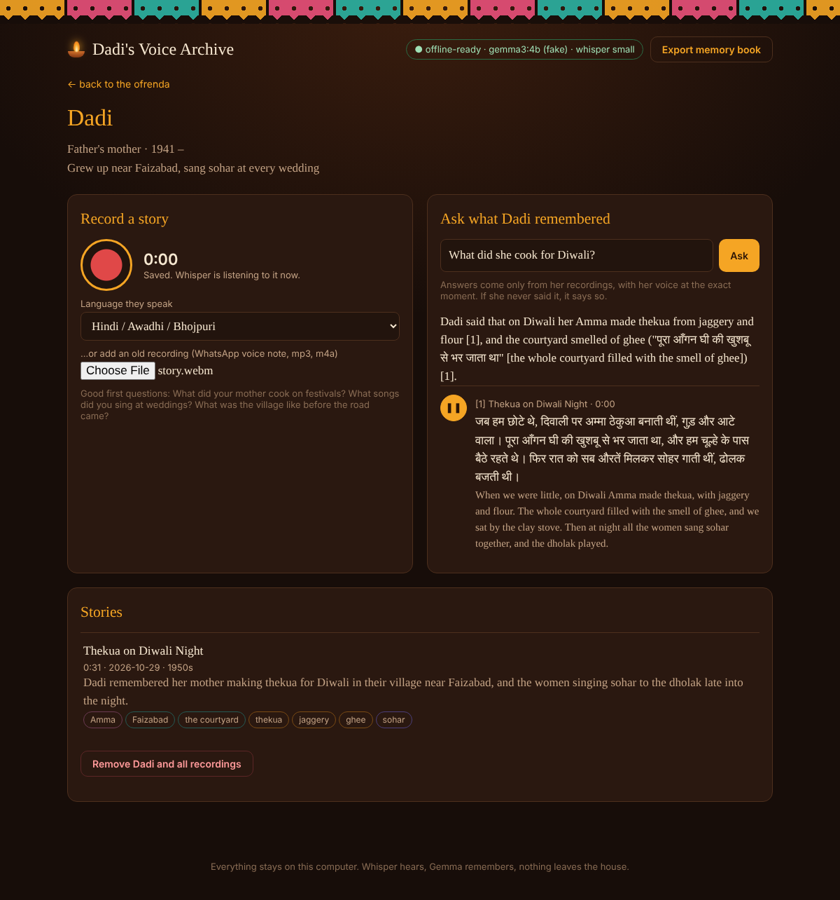

# 🪔 Dadi's Voice Archive

**An offline oral-history altar for the people who carry your family's stories.**

Record your grandmother telling a story in Hindi, Awadhi or any language she speaks. Open-weight **Whisper** writes down every word with timestamps. A local **Gemma** model (via Ollama) translates it line by line, gives it a title, pulls out the people, places, foods and songs she mentioned, and finds the one sentence worth keeping. Then the family can *ask* what she remembered, and the answer plays **her actual voice** at the exact moment she said it.

Nothing leaves the computer. No account, no cloud, no API key.



## Why it exists

The elders in our families don't write memoirs. Their stories live in voice, in dialect, in songs that change from one village to the next. Cloud transcription is bad at Awadhi, and putting a grandmother's private memories on someone else's server feels wrong. This tool keeps the stories at home and makes them findable and understandable for grandchildren who don't speak the language as well.

## Features

- **Record or upload**: record in the browser, or drop in old WhatsApp voice notes (`.opus`, `.ogg`, `.m4a`, `.mp3`, `.wav`).
- **Local transcription**: faster-whisper (CTranslate2), timestamped segments, VAD to skip long pauses.
- **Gemma remembers**: line-by-line English translation, a title, a summary, people / places / foods / songs / era, and a *keepsake* quote kept in her original words.
- **Ask, grounded in her voice**: BM25 retrieval over the original and translated lines, with Gemma expanding the question into Hindi and English keywords. Gemma answers only from the excerpts it was given and cites them, and every source has a ▶ button that plays her voice. If she never talked about it, the app says so instead of making something up.
- **Never pretends to be her**: the archivist speaks *about* her ("Dadi said…") and quotes her. It never role-plays a dead person.
- **Survives the app**: *Export memory book* gives you a zip with plain HTML and the audio files. It opens in any browser, years from now, with no software installed.
- **Resilient**: if Ollama is off, her words are still transcribed and searchable. Press *Remember again* later.

## Run it

You need Python 3.10+ and [Ollama](https://ollama.com).

```bash
ollama pull gemma3:4b        # or any Gemma: gemma3:1b on a weak laptop, a Gemma 4 tag if you have one
git clone https://github.com/GamerxD01/The-Spirit-of-It
cd The-Spirit-of-It
./run.sh                     # Windows: run.bat
```

Open http://127.0.0.1:8000. The first transcription downloads the Whisper model once (about 460 MB for `small`). After that the app works fully offline.

| Setting | Env var | Default |
|---|---|---|
| Ollama model | `DVA_MODEL` | first installed `gemma*` model |
| Whisper size | `DVA_WHISPER` | `small` (try `medium` for heavy dialect) |
| Whisper device | `DVA_WHISPER_DEVICE` | `auto` |
| Data folder | `DVA_DATA_DIR` | `./data` |
| Ollama URL | `DVA_OLLAMA_URL` | `http://127.0.0.1:11434` |

## How it works

```
 mic / voice note ─► faster-whisper ─► timestamped Hindi segments ─┐
                                                                    ├─► SQLite + audio files (./data)
                     Gemma (Ollama) ─► translation, title, tags,  ─┘
                                       keepsake quote
 question ─► Gemma keyword expansion (EN + हिंदी) ─► BM25 over segments ─► Gemma grounded answer + [n] citations
                                                                        └─► ▶ plays her voice from segment start to end
```

- `app/asr.py`: Whisper wrapper
- `app/llm.py`: local Ollama client (auto-picks a Gemma model)
- `app/pipeline.py`: transcription, translation, memory card and grounded Ask prompts
- `app/search.py`: dependency-free BM25 that handles Devanagari
- `app/export.py`: the plain HTML memory book
- `app/static/`: vanilla JS front end with no CDN or web fonts, so it works offline

## Tests

```bash
pip install pytest && python -m pytest -q
```

The tests use fake Whisper and Gemma models (`tests/fakes.py`), so they run without downloading any model. `python -m tests.demo_server` starts the UI with those fakes.

## License

MIT
